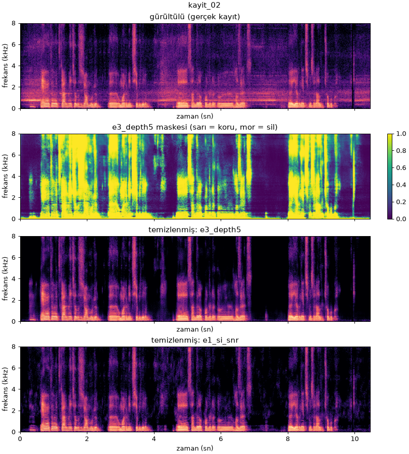
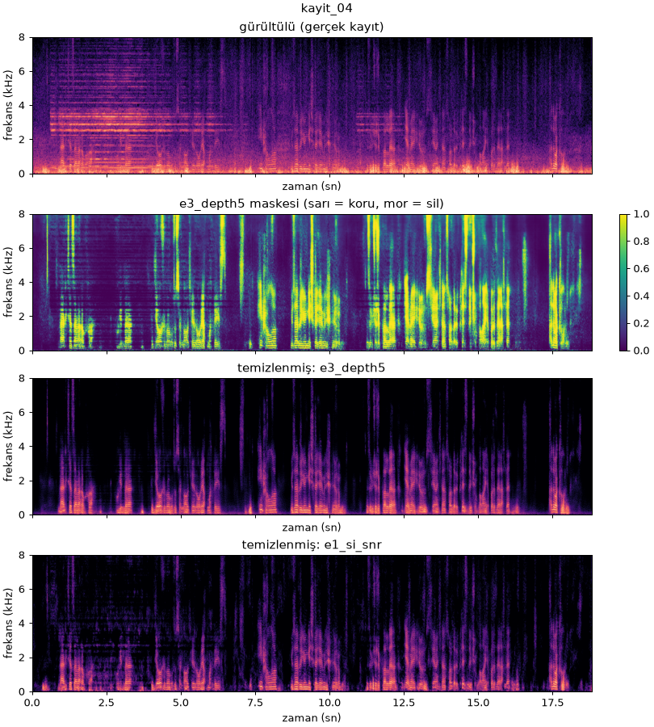
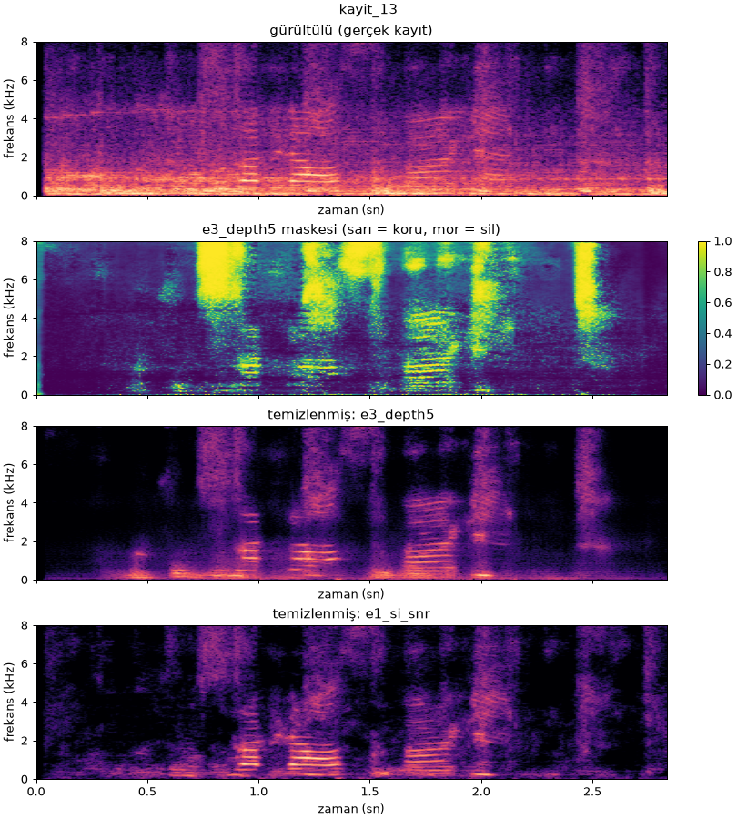

# E7: gerçek kayıtlar

Telefonla (WhatsApp) kaydedilmiş 19 gerçek ortam kaydı, en iyi iki modelle (`e3_depth5`, `e1_si_snr`; tohum 42)
temizlendi. Kayıtların toplam süresi yaklaşık 3,5 dakika (kayıt başına 2,8–27,4 sn). Kayıtların kendisi gizlilik nedeniyle
depoya eklenmez (`data/raw/gercek_kayit/`, `.gitignore` kapsamında).

```bash
uv run python -m src.real_recordings --config configs/e7_real.yaml   # -> experiments/e7_gercek_kayit/
```

## Nasıl ölçüldü

Gerçek kayıtların temiz hali bilinmediği için SI-SNR, PESQ ve STOI hesaplanamaz. Asıl değerlendirme dinleme ve
spektrogramlarla yapıldı. Buna ek olarak, referans gerektirmeyen kaba bir enerji özeti çıkarıldı. Kayıt 20 ms'lik
çerçevelere bölündü ve iki seviye ölçüldü:

- **Gürültü tabanı:** en sessiz %10'luk çerçevelerin enerjisi (konuşma olmayan anlar).
- **Konuşma seviyesi:** en yüksek %5'lik çerçevelerin enerjisi.

Tablolarda her birinin model çıktısında kaç dB **düştüğü** var. İdeal sonuç: taban çok düşer, konuşma seviyesi
neredeyse hiç düşmez. Bu bir yaklaşıklıktır: gürültünün çok yüksek olduğu kayıtlarda en yüksek çerçeveler de gürültü
içerir, bu yüzden "konuşma düşüşü"nün bir kısmı aslında kaldırılan gürültüdür.

## Sonuçlar

Kayıtlar, kaydedildikleri ortama göre iki gruba ayrılıyor:

- **A, sessiz ortam (9 kayıt):** 17:07–17:33 arası sesli mesajlar (kayıt 01–03, 06–10) ve kayıt 19. Arka plan
  gürültüsü düşük ve geniş bantlı (ortalama taban −35,4 dB).
- **B, gürültülü ortam (10 kayıt):** arkada müzik ya da melodik ses olan iki kayıt (04–05) ve 22:01'de kaydedilen
  sekiz kayıt (11–18). Bu ikinci grupta 1 kHz altında güçlü, sürekli bir uğultu ve bazılarında 4 kHz civarında bir
  ton var (ortalama taban −26,8 dB).

Grup ortalamaları (dB, parantez içinde en düşük–en yüksek):

| Grup | Model | Taban düşüşü | Konuşma düşüşü |
|---|---|---|---|
| A (9) | e3_depth5 | 29,7 (18,9–35,5) | 0,2 (0,0–0,4) |
| A (9) | e1_si_snr | 25,4 (16,0–36,3) | 0,4 (0,2–0,8) |
| B (10) | e3_depth5 | 35,3 (29,4–39,4) | 5,8 (1,2–10,0) |
| B (10) | e1_si_snr | 31,1 (26,8–34,9) | 6,1 (2,1–12,5) |

<details>
<summary>Kayıt bazında tablo</summary>

| Kayıt | Grup | Süre (sn) | Taban (dB) | e3_depth5 taban ↓ | e3_depth5 konuşma ↓ | e1_si_snr taban ↓ | e1_si_snr konuşma ↓ |
|---|---|---|---|---|---|---|---|
| 01 | A | 7,7 | −44,4 | 18,9 | 0,1 | 16,0 | 0,4 |
| 02 | A | 10,5 | −37,7 | 31,7 | 0,1 | 25,1 | 0,2 |
| 03 | A | 14,3 | −35,0 | 33,7 | 0,2 | 30,5 | 0,5 |
| 04 | B | 18,8 | −30,1 | 32,7 | 7,4 | 34,5 | 8,1 |
| 05 | B | 18,7 | −22,7 | 33,6 | 6,3 | 34,9 | 7,0 |
| 06 | A | 14,8 | −33,0 | 29,3 | 0,3 | 25,9 | 0,6 |
| 07 | A | 15,8 | −31,8 | 30,8 | 0,1 | 24,1 | 0,4 |
| 08 | A | 17,0 | −35,7 | 32,4 | 0,0 | 24,0 | 0,4 |
| 09 | A | 27,4 | −40,2 | 23,7 | 0,2 | 21,3 | 0,2 |
| 10 | A | 16,7 | −28,0 | 35,5 | 0,4 | 36,3 | 0,8 |
| 11 | B | 3,9 | −26,0 | 36,5 | 5,6 | 29,4 | 5,7 |
| 12 | B | 2,9 | −23,5 | 39,3 | 8,6 | 30,5 | 12,5 |
| 13 | B | 2,8 | −25,7 | 39,0 | 10,0 | 34,7 | 4,2 |
| 14 | B | 3,3 | −31,0 | 32,5 | 4,4 | 30,4 | 5,5 |
| 15 | B | 5,0 | −29,9 | 29,4 | 1,2 | 26,8 | 2,1 |
| 16 | B | 3,3 | −24,8 | 36,8 | 3,6 | 28,0 | 4,8 |
| 17 | B | 16,7 | −28,0 | 33,4 | 4,0 | 30,5 | 3,1 |
| 18 | B | 3,4 | −26,3 | 39,4 | 7,3 | 31,3 | 7,8 |
| 19 | A | 5,2 | −33,1 | 30,9 | 0,3 | 25,2 | 0,4 |

</details>

## Yorum

- **Sessiz ortamda (A) model beklendiği gibi çalışıyor.** Arka plan 19–36 dB bastırılırken konuşma seviyesi
  1 dB'den az değişiyor. Spektrogramlarda konuşmanın harmonikleri korunuyor (kayıt 02).
- **`e3_depth5` daha agresif.** Gürültü tabanını `e1_si_snr`'dan ortalama 4 dB daha fazla düşürüyor, özellikle
  konuşma aralarında. `e1_si_snr` konuşmaya biraz daha nazik ama arkada daha fazla gürültü bırakıyor. Bu durum
  sentetik testteki tabloyla da tutarlı: `e3_depth5` PESQ ve STOI'de, `e1_si_snr` SI-SNR'da önde.
- **Müzikte (04–05)** `e3_depth5` melodik bileşenleri neredeyse tamamen siliyor; `e1_si_snr` ise ton kalıntıları
  bırakıyor. Burada "konuşma düşüşü"nün önemli bir kısmı kaldırılan müzikten geliyor.
- **Düşük frekanslı uğultuda (11–18) konuşma da zarar görüyor.** Model 1 kHz altındaki bandı bütünüyle
  bastırırken konuşmanın temel frekansını ve alt harmoniklerini de kesiyor (kayıt 13). Sonuç ses daha ince ve
  metalik duyulabilir.

## Sınırlılıklar

- **Dağılım dışı gürültü:** sürekli düşük frekanslı uğultu ve müzik, eğitimde kullanılan ESC-50 sınıflarında
  yok ya da çok az var. E6'da görülmemiş ESC-50 sınıflarında SI-SNR iyileşmesindeki düşüş küçüktü (deneye göre 0,0–0,6 dB);
  ama gerçek kayıtlarda karşılaşılan gürültü türleri ESC-50'den daha da uzak. Bu, sentetik test sonuçlarının
  gerçek ortama doğrudan genellenemeyeceğini gösteriyor.
- **Mikrofon ve sıkıştırma:** kayıtlar telefon mikrofonuyla alınıp WhatsApp tarafından Opus/AAC ile sıkıştırıldı;
  eğitim verisi (LibriSpeech, FLAC) bu bozulmaları içermiyor.
- **Faz:** model yalnızca genliği düzeltiyor, faz gürültülü sinyalden alınıyor. Gürültünün güçlü olduğu yerlerde
  bu durum hafif bir "robotik" tını bırakabilir.
- **Ölçüm:** enerji özeti algılanan kaliteyi ölçmez; sistematik bir dinleme testi (ör. MOS) yapılmadı ve örnek
  sayısı az (19 kayıt).

## Örnek spektrogramlar

Her görselde yukarıdan aşağı: gürültülü kayıt, `e3_depth5` maskesi (sarı = koru, mor = sil), `e3_depth5` çıktısı,
`e1_si_snr` çıktısı. Spektrogramlar aynı dB ölçeğinde.

**Kayıt 02 (A, sessiz ortam):** gürültü gidiyor, konuşma korunuyor.



**Kayıt 04 (B, arkada müzik):** 2–4 kHz'deki yatay harmonik çizgiler `e3_depth5`'te silinmiş, `e1_si_snr`'da kısmen
kalmış.



**Kayıt 13 (B, düşük frekanslı uğultu):** 1 kHz altı bant, konuşmanın alt harmonikleriyle birlikte bastırılmış.


